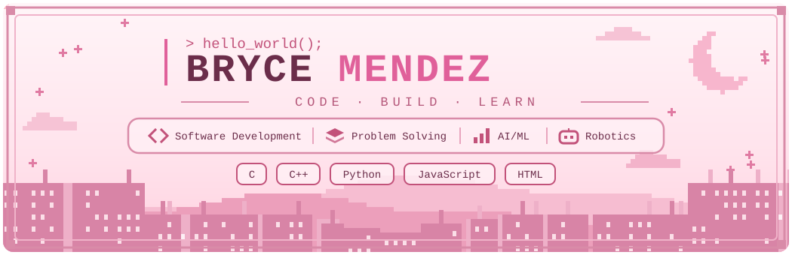

## ✦ About

Hi, I'm **Bryce Mendez**. I enjoy building things, solving problems, and learning something new every day.

- 🔭 Currently working on: *add your project*
- 🌱 Currently learning: *add your topics*
- 💬 Ask me about: *add your interests*

## 🛠 Technologies

## ◈ GitHub Stats

## ⌘ Connect

[GitHub](https://github.com/BryceMendez) · [LinkedIn](https://linkedin.com/in/your-handle) · [Email](mailto:you@example.com)

✦ Code · Build · Learn ✦

